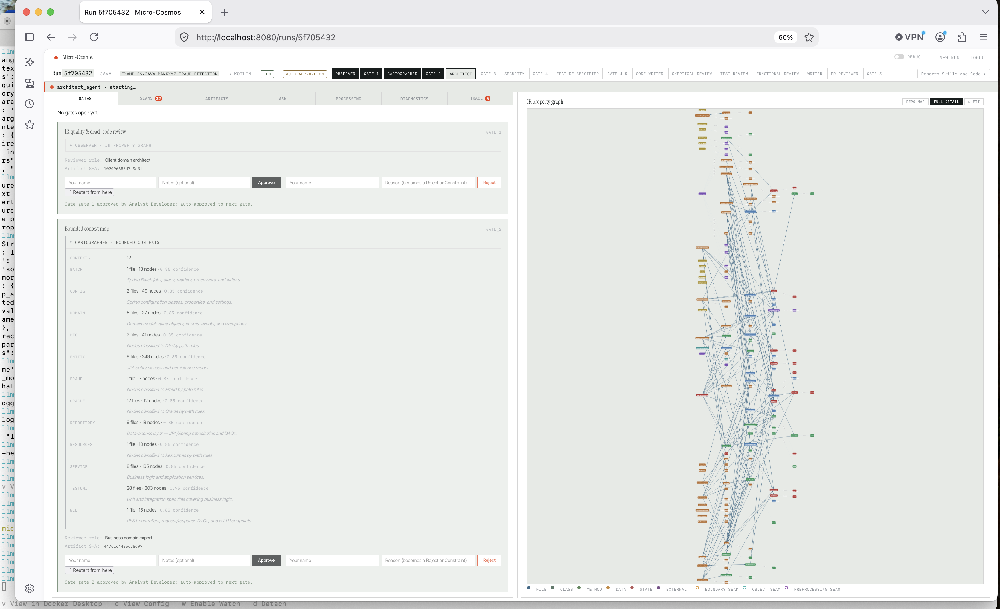
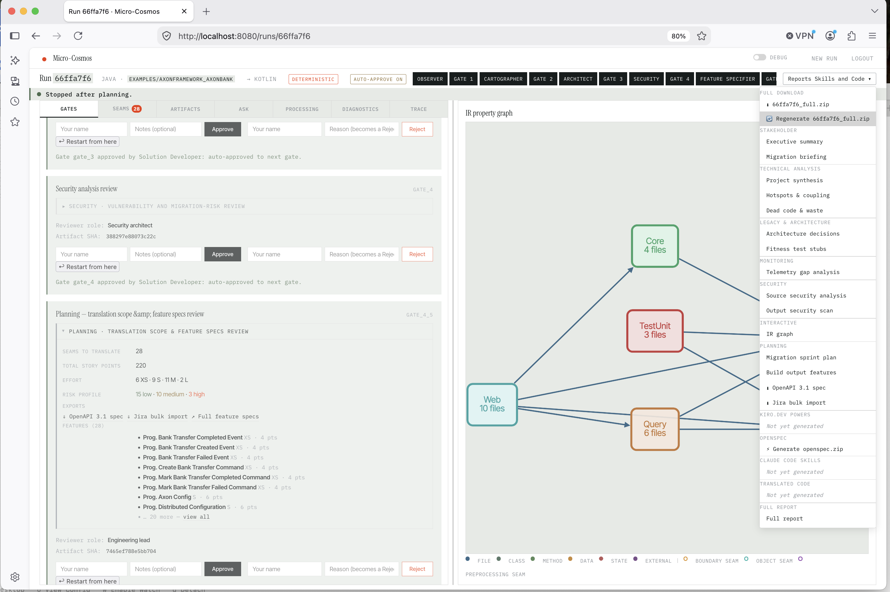
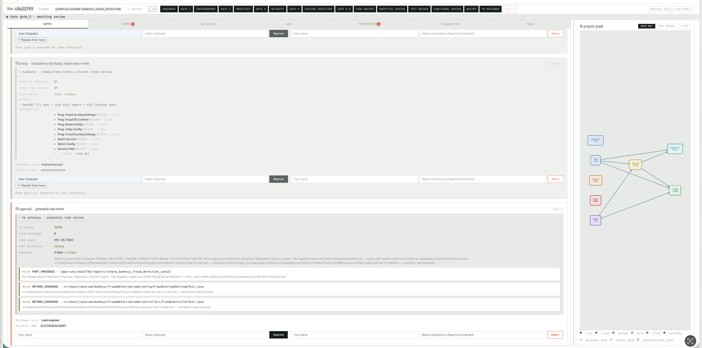
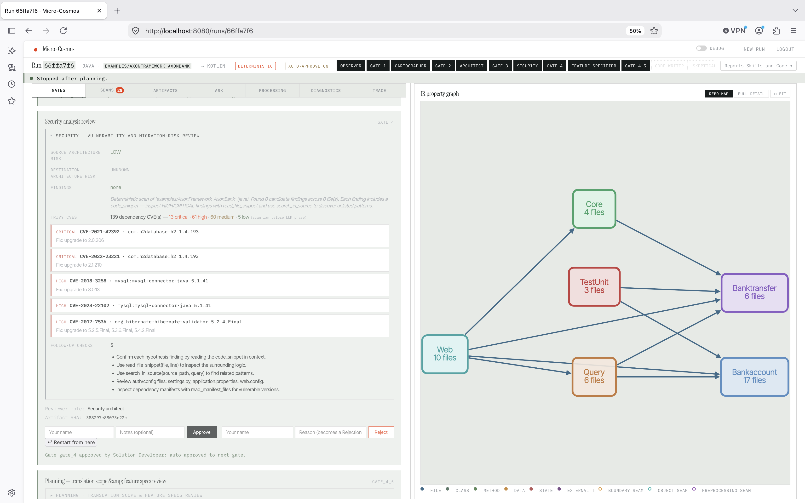
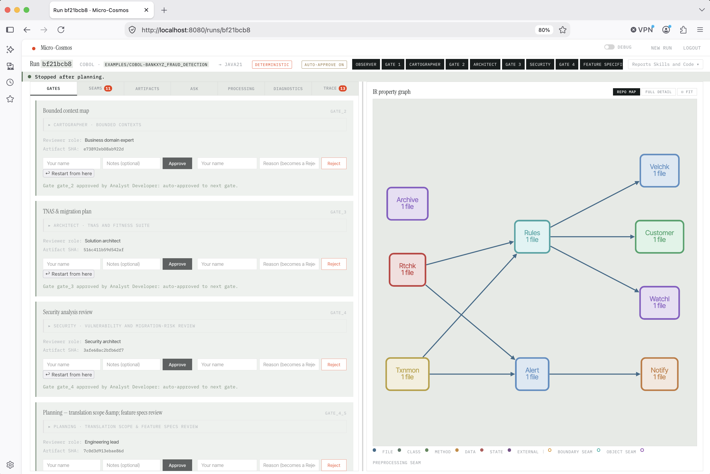
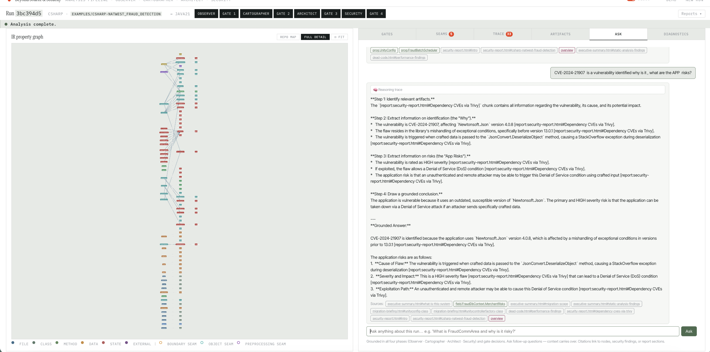
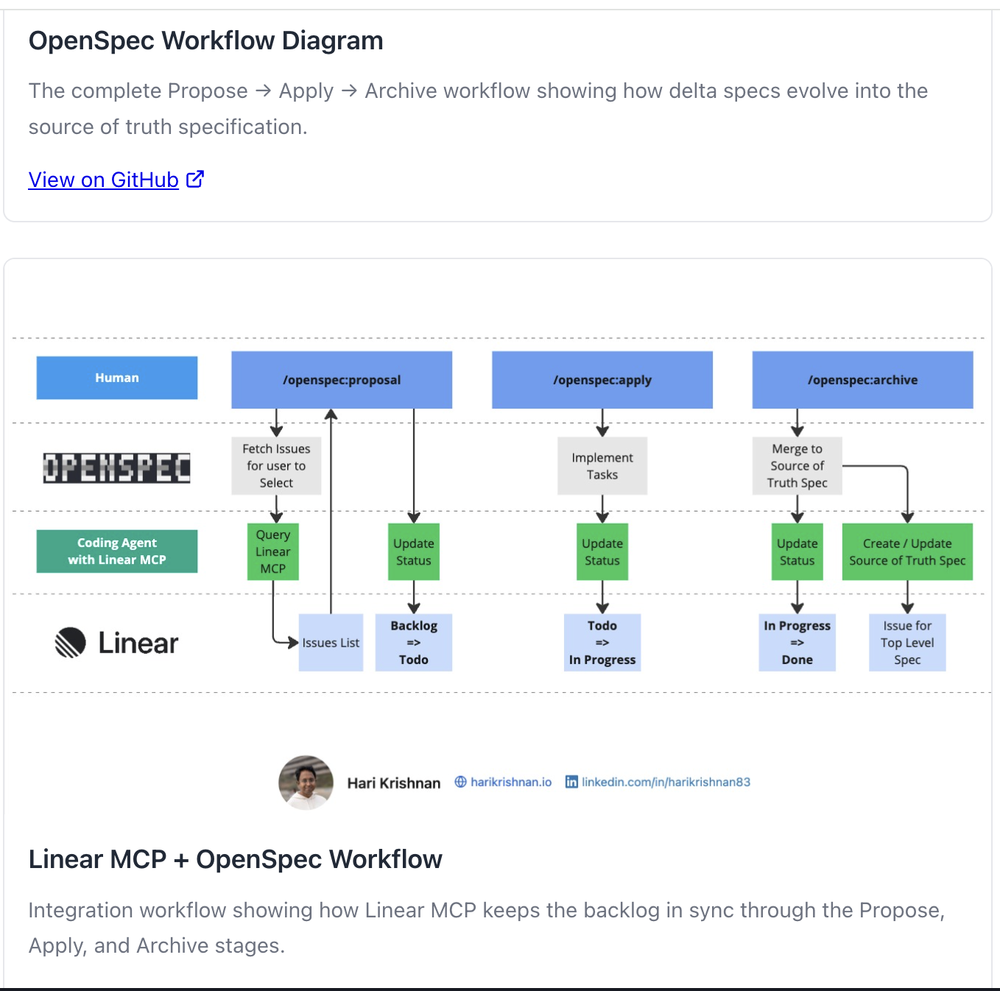

<div align="center">
  <br>
  <h1>Micro-Cosmos</h1>
  <p><em>Agentic source-to-source code translation with five human gates and dual Trivy security scanning.</em></p>
  <p><code>Micro-Cosmos · v0.1.0</code></p>
  <br>
</div>

---

Micro-Cosmos translates a legacy source estate into idiomatic, production-quality target-language code using an eleven-agent pipeline with TDD review loops and five human-approval gates. Local Compose sends OpenAI `/v1` traffic through an `llm-gateway` proxy (LiteLLM) to Ollama by default; dormant profiles cover LM Studio, vLLM, AWS Bedrock, and Vertex AI. Google Vertex AI (`LLM_ENGINE=vertex` on the **app**, bypassing the gateway) is **partially implemented** — the agent pipeline runs on Gemini through it, but Claude-on-Vertex, the ASK tab, and embeddings are not covered, and IAM is not automated. Prefer `LLM_PROFILE=vertex` on the gateway when you want Vertex through the same `/v1` hop. See [Vertex AI / Gemini — what works, what doesn't](#vertex-ai--gemini-partially-implemented) for the exact boundary.

---

## Quickstart — demo from a GitHub URL or a zip upload

The fastest way to try Micro-Cosmos is to open the demo page and point it at a project — either
paste a public GitHub repository URL, or upload any Git repository as a `.zip` archive.

### 0. Configure your `.env` file (first time only)

Micro-Cosmos ships with **Deterministic mode on by default** (`SKIP_LLM=true`) — no LLM backend,
no API key, and no `.env` file are required for a first build and run. `docker-compose.yml` reads
its values from `.env` in the repo root, so this step is only needed if that file doesn't exist yet
or if you want LLM mode from the start:

```bash
cp .env.example .env
```

`.env` is git-ignored — it's local-only and never committed. You don't need to edit anything in it
to try the app in Deterministic mode; every variable below has a working default. Edit it only if
you want **LLM mode** (real model calls, not symbolic fallbacks):

| Variable | Required for LLM mode? | What to set |
|---|---|---|
| `SKIP_LLM` | — | `false` to enable LLM mode for every run (also switches the ASK tab and embeddings). Leave `true`/unset for Deterministic mode. Can also be set per-run from the web UI's mode toggle without touching `.env`. |
| `LLM_BASE_URL` | Yes | Compose default is `http://llm-gateway:4000/v1` (LiteLLM proxy, in-network). Host probe of the gateway is `http://localhost:4001/v1` (mapped 4001→4000 so it can sit next to agentic-security on 4000). Direct Ollama on the host is `http://localhost:11434/v1` (venv) or `http://host.docker.internal:11434` on the **gateway** (`OLLAMA_API_BASE`). Direct LM Studio/vLLM without the proxy still use port `1234` / `8000`. |
| `LLM_API_KEY` | Yes | Must match the gateway `LITELLM_MASTER_KEY` in Compose (`sk-micro-cosmos-local`). Direct Ollama ignores auth. |
| `LLM_ENGINE` | Yes | Compose: `gateway`. Host venv without the proxy: `ollama` / `lmstudio` / `vllm` / `vertex`. |
| `LLM_PROFILE` | No | Gateway backend: `ollama` (default), or dormant `lmstudio` / `vllm` / `bedrock` / `vertex`. Restart **only** `llm-gateway` after changing it. No failover. |
| `MODEL_REASONING`, `MODEL_FAST` | Yes | The model name(s) your backend actually serves, e.g. `google/gemma-4-e4b`. Must match what the backend reports — see [Configuration](#configuration) for the recommended model and alternatives. |
| `MODEL_CONTEXT_LENGTH` | Yes | KV-cache window in tokens, e.g. `131072` for gemma-4's full 128K context. Must not exceed what your backend was started with. |
| `MODEL_TEMPERATURE` | No | Sampling temperature (0.0–2.0). Leave unset to use the model's own default. |
| `MAX_TDD_ITERATIONS_PER_SEAM` | No | Cap on Code Writer/review retries per seam (default `3`) before the TDD loop moves on. |
| `DEMO_USERNAME`, `DEMO_PASSWORD` | No | Override the web UI login (defaults `demo`/`demobxyz`). |

> `LLM_ENGINE=vertex` routes through Google Cloud Vertex AI (Gemini via Model Garden) instead of a
> self-hosted backend — set `GOOGLE_GENAI_USE_VERTEXAI=TRUE`, `GOOGLE_CLOUD_PROJECT`, and
> `GOOGLE_CLOUD_LOCATION` in `.env`; auth is Application Default Credentials, not an API key. See
> [Vertex AI / Gemini](#vertex-ai--gemini-partially-implemented) below for the local setup steps.

If you start an LLM-mode run without a real backend reachable at `LLM_BASE_URL`, the run
waits (best-effort, up to 25 minutes) for a model to report as loaded, then fails gracefully rather
than hanging forever — see [Run modes](#run-modes).

### 1. Start the container

```bash
docker compose up --build
```

The app starts at **http://localhost:8080**.  
Logs are streamed to the terminal. Wait for:

```
INFO:     Application startup complete.
INFO:     Uvicorn running on http://0.0.0.0:8080
```

Every page requires login — you'll be redirected to **http://localhost:8080/login**. Default credentials (override via `DEMO_USERNAME`/`DEMO_PASSWORD` in `docker-compose.yml` or `.env`):

```
username: demo
password: demobxyz
```

On success you land on `/` — the example chooser. Sessions are a signed cookie (no database) — they reset if the container restarts, which is expected for local dev.

### 2. Open the launch page

Go to **http://localhost:8080/** (the old `/demo` URL permanently redirects here)

You will see:
- A **GitHub URL box** at the top — paste a public repo URL to fetch it directly
- A **project picker** in the middle — pre-loaded examples shipped with the app
- An **upload zone** at the bottom — drag-and-drop area for `.zip` files, for repos you can't (or don't want to) fetch by URL

### 3. Add your project

**Option A — paste a GitHub URL**

Paste a public repository URL, e.g. `https://github.com/owner/repo` (an optional `/tree/<branch>`
is supported too), into the box at the top and click **"Fetch"**.

What happens:
1. The URL is validated — only `github.com` URLs are accepted
2. The server downloads the repo as a zip from GitHub directly (`codeload.github.com`, no `git` needed) and extracts it, same as a manual upload
3. A new card appears at the top of the picker, already selected — no page reload required

Private repositories aren't supported yet — GitHub's zip-download endpoint requires
authentication for those, so a private URL returns a clear "not found" error rather than a
confusing extraction failure.

**Option B — upload a zip**

Export any Git repository as a `.zip` (GitHub → *Code → Download ZIP*, GitLab → *Download source code → zip*) and either:

- **Drag and drop** the `.zip` file onto the upload zone at the bottom of the page, or
- Click **"Browse .zip"** and select it from the file picker

What happens:
1. The zip is validated (must be `.zip`, max 200 MB)
2. A progress bar tracks the upload
3. GitHub-style single-root prefix is automatically stripped (e.g. `my-repo-main/` → `my-repo/`)
4. The project is extracted into `examples/<project-name>/`
5. A new card appears at the top of the picker, already selected — no page reload required
6. Sub-folders are detected and listed so you can target a specific module

### 4. Configure the run

With a project card selected, the launch form appears on the right:

| Field | What to set |
|-------|-------------|
| **Source language** | Auto-detected from file extensions — confirm or override |
| **Target language** | The language to translate into (`kotlin`, `go`, `python3`, `typescript`, `java21`, `rust`, `csharp`, `scala`, `swift`, `javascript`) |
| **Sub-folder** | If your zip contains multiple modules, select the one to translate |
| **Mode** | LLM (full agentic pipeline) or Deterministic (symbolic fallbacks, no model calls) |

### 5. Start the pipeline

Click **"Start translation →"**

You are redirected to the run page at `/run/<run-id>`. The pipeline begins immediately.

---

## What the pipeline does

The eleven-agent pipeline runs in order. Each phase writes a JSON artifact to `runs/<run-id>/`. Human gates pause the pipeline until you approve or reject from the UI.

```
Source estate
      │
  [Trivy prescan]        → trivy_report.json       (CVE scan of source dependencies)
      │
  [Observer]             → ir_graph.json            (IR property graph)
  [Gate 1]               ← human: review IR
      │
  [Cartographer]         → bounded_context_map.json (bounded contexts)
                         → seam.json                (seam list with migration steps)
                         → work_streams.json        (work streams for sprint planning)
  [Gate 2]               ← human: approve context boundaries
      │
  [Architect]            → tnas.json                (TNAS + fitness suite)
                         → HTML reports: synthesis, briefing, hotspots, ADRs, sprint plan, ...
  [Gate 3]               ← human: approve architecture
      │
  [Security]             → security_report.json
                         → reports/security-report.html
  [Gate 4]               ← human: accept security findings
      │
  [Feature Specifier]    → feature_specs.json           (per-seam feature specs)
                         → reports/feature-specs.html   (lazily generated)
  [Gate 4.5 "Planning"]  ← human: review translation scope before code gen starts
      │                    panel: seam count · story points · effort/risk breakdown
      │                    exports: OpenSpec 3.1 spec · Jira bulk import
      │ APPROVED
      ▼
  ── Skills & Kiro.dev Powers created once here ──
  │
  for each seam (from seam.json):
    [Code Writer]        ← rich kickoff: seam type, source file, fan-in evidence,
    │                      migration steps, architecture guidance (substitution_note)
    [Skeptical Review]   ← checks every function for stubs, wrong types, logic errors
    [Test Review]        ← enforces happy-path + rule-violation + edge-case tests
    [Functional Review]  ← verifies source business rules are faithfully preserved
    (TDD loop, up to 5 iterations per seam)
    [Writer]             → appends seam files to reports/<project>_<lang>/
      │
  [PR Reviewer]          → review_report.json       (8-check automated code review)
  [Gate 5]               ← human: approve generated code
      │
  [Trivy output scan]    → trivy_output_report.json (CVE scan of generated output)
                         → reports/output-security-report.html
      │
  pipeline_completed
```

---

## Output files

All generated artifacts land inside `runs/<run-id>/reports/`. The run root contains only JSON analysis artifacts.

```
runs/<run-id>/
├── ir_graph.json
├── bounded_context_map.json
├── seam.json
├── work_streams.json
├── tnas.json
├── security_report.json
├── feature_specs.json
├── review_report.json
├── trivy_report.json
├── trivy_output_report.json
│
└── reports/
    ├── <project>_<lang>/                        ← translated source code
    │   ├── src/main/<lang>/com/...              (JVM) or equivalent source root
    │   ├── build.gradle.kts                     (or pom.xml, go.mod, Cargo.toml, …)
    │   └── README.md                            ← generated module README
    │
    ├── <project>_<lang>_skills/                 ← Claude Code skills
    │   ├── CLAUDE.md                            ← project context, auto-loaded by Claude Code
    │   └── .claude/
    │       └── commands/
    │           ├── translate-seam.md            ← /translate-seam <seam-name>
    │           ├── code-review.md               ← /code-review <file-or-folder>
    │           ├── terraform-review.md          ← /terraform-review
    │           ├── monitoring-review.md         ← /monitoring-review
    │           └── security-review.md           ← /security-review
    │
    ├── kiro-dev-powers-app-modernization/       ← Kiro.dev Powers (five powers)
    │   ├── micro-cosmos-code-writer-power/
    │   ├── micro-cosmos-code-reviewer-power/
    │   ├── micro-cosmos-terraform-power/
    │   ├── micro-cosmos-monitoring-power/
    │   └── micro-cosmos-security-power/
    │
    ├── openspec/                                ← OpenSpec (Fission-AI convention) tree
    │   ├── project.md
    │   ├── specs/<work-stream>/spec.md, specs/{security,observability,testing}/spec.md
    │   ├── changes/<lang>-to-<lang>-migration/{proposal,design,tasks}.md
    │   └── archive/                              ← empty; populated by your own later workflow
    │
    ├── security-report.html
    ├── output-security-report.html
    ├── feature-specs.html                       ← lazily generated on first click
    ├── monitoring.html                          ← lazily generated on first click
    ├── synthesis.html, briefing.html, …         ← all generated by Node.js scripts
    │
    ├── <project>_<lang>.zip                     ← generated on demand (Downloads menu)
    ├── <project>_<lang>_skills.zip
    ├── kiro-dev-powers-app-modernization.zip
    └── openspec.zip
```

**Example** — translating `java-mybank_fraud_detection` to Kotlin:

```
runs/5d367aca/reports/
├── java_mybank_fraud_detection_kotlin/
│   ├── src/main/kotlin/com/bankxyz/fraud/...
│   ├── build.gradle.kts                 ← dependencies merged across all seams
│   └── README.md
├── java_mybank_fraud_detection_kotlin_skills/
│   ├── CLAUDE.md
│   └── .claude/commands/
│       ├── translate-seam.md
│       ├── code-review.md
│       ├── terraform-review.md
│       ├── monitoring-review.md
│       └── security-review.md
├── kiro-dev-powers-app-modernization/
│   ├── micro-cosmos-code-writer-power/
│   ├── micro-cosmos-code-reviewer-power/
│   ├── micro-cosmos-terraform-power/
│   ├── micro-cosmos-monitoring-power/
│   └── micro-cosmos-security-power/
└── openspec/
    ├── project.md
    ├── specs/
    └── changes/
```

**Build file accumulation:** `pom.xml`, `build.gradle.kts`, `go.mod`, `Cargo.toml`, `package.json`, `pyproject.toml`, and `build.sbt` are *merged* across seams — each seam's new dependencies are appended to the existing file rather than overwriting it. This ensures the final build descriptor covers all dependencies from all translated seams.

The Claude Code skills folder and Kiro.dev Powers are created **once before the first seam starts**, so they are available immediately as code accumulates seam by seam.

---

## Run dashboard

Each run has a live dashboard at `/run/<run-id>`:

| Panel | What it shows |
|-------|---------------|
| **Phase strip** | 17 pills: `observer gate_1 cartographer gate_2 architect gate_3 security gate_4 feature_specifier gate_4_5 code_writer skeptical_review test_review functional_review writer pr_reviewer gate_5`. Active phase pulses. |
| **Live trace** | Real-time agent output and tool calls streamed over WebSocket. Includes per-seam progress (`seam_started`, `seam_completed` events). |
| **Gate panel** | Opens automatically at each gate. Approve or reject with notes. Rejection becomes a `RejectionConstraint` passed to the re-run. Gate 5 rejection re-runs all seams. |
| **Artifact inspector** | Browse IR graph, TNAS, seam report, PR review, Trivy reports by clicking phase pills. |
| **Reports menu** | Grouped HTML reports, interactive artefacts, and downloadable output folders. |
| **ASK tab** | Multi-turn RAG chat over all run artifacts — ask questions about CVEs, bounded contexts, migration risk, feature specs, etc. |

### Reports menu structure

The **Reports Skills and Code ▾** hamburger menu on the run page groups all generated output:

| Group | Items | Generated by |
|---|---|---|
| **Stakeholder** | Executive summary, Migration briefing | Architect |
| **Technical analysis** | Project synthesis, Hotspots & coupling, Dead code & waste | Architect |
| **Legacy & Architecture** | Architecture decisions, Fitness test stubs | Architect |
| **Monitoring** | Telemetry gap analysis | Lazy (generate_monitoring.js) |
| **Security** | Source security analysis, Output security scan | Security agent + Trivy output scan |
| **Interactive** | IR graph | Observer |
| **Planning** | Migration sprint plan, Build output features, ⬇ OpenAPI 3.1 spec, ⬇ Jira bulk import | Architect · Feature Specifier |
| **Kiro.dev Powers** | ⚡ Generate / ⬇ Download `.zip` (includes hidden `.kiro/` dirs) | Writer (`_write_kiro_powers`) |
| **OpenSpec** | ⚡ Generate / ⬇ Download `openspec.zip` — always force-regenerates content from the latest `feature_specs.json`/`tnas.json`/`security_report.json`, unlike Skills/Kiro Powers | Writer (`_write_openspec`) |
| **Claude Code skills** | ⚡ Generate / ⬇ Download `_skills.zip` | Writer (`_write_output_skills`) |
| **Translated code** | ⚡ Generate / ⬇ Download output `.zip` | Writer |

All HTML reports are **lazily generated** on first click — the Node.js script runs once and the result is cached. For reports that require a prerequisite artifact (e.g. `feature_specs.json` for `feature-specs.html`, `work_streams.json` for sprint plan), clicking before the pipeline reaches that phase shows a styled "not yet available" page with an auto-refresh every 20 seconds; after the pipeline completes without the artifact, it shows the exact `curl` restart command instead of a raw 500 error.

ZIP downloads use a two-step flow: the **⚡ Generate** button compresses the folder server-side and saves it to `reports/`; the **⬇ Download** link then serves the pre-built file directly with no async JS in the loop.

---

## Feature specs, OpenAPI, and Jira export

> **Naming note:** this section is about the **OpenAPI 3.1** export (`openapi.yaml`,
> `GET /runs/{id}/export/openapi`) — an internal naming mismatch used to call this
> "OpenSpec" everywhere despite it being a genuine OpenAPI document; that's fixed now.
> For the real, separate **OpenSpec** (the [Fission-AI/OpenSpec](https://github.com/Fission-AI/OpenSpec)
> Markdown convention), see [OpenSpec](#openspec) below.

After all seams are translated, the **Feature Specifier** agent generates `feature_specs.json` — one spec per seam containing:

| Field | Description |
|---|---|
| `title`, `description`, `business_value` | LLM-authored business-readable spec |
| `acceptance_criteria[]` | Numbered acceptance criteria |
| `api_surface` | Inferred REST/gRPC surface (null for non-API seams) |
| `jira_issue_type`, `jira_labels`, `story_points` | Jira-ready metadata |
| `effort`, `risk`, `migration_phase`, `work_stream_id` | From seam report |

**`feature-specs.html`** (Reports → Planning → Build output features) shows: overview metrics, work stream table (maps to Jira Epics), per-seam spec cards with acceptance criteria, API surface, and export buttons.

Two export download links appear in the **Reports → Planning** group once `feature_specs.json` exists (shown as dimmed "not yet generated" before that):

| Menu item | Format | Notes |
|---|---|---|
| ⬇ OpenAPI 3.1 spec | `openapi.yaml` (OpenAPI 3.1) | REST/gRPC seams → `paths`; all seams → `components/schemas`. Endpoint: `GET /runs/{id}/export/openapi` |
| ⬇ Jira bulk import | `jira_bulk_import.json` | Work streams → Epics; seams → Stories with ADF bodies linked via `customfield_10014`. Endpoint: `GET /runs/{id}/export/jira?project_key=ALX` — directly POSTable to `/rest/api/3/issue/bulk` |

---

## Claude Code skills — all commands

Every generated `<project>_skills/` folder includes five Claude Code commands:

| Command | Description |
|---|---|
| `/translate-seam <seam-name>` | Translate a source seam to the target language following hexagonal conventions, correct decimal type, and OTel instrumentation |
| `/code-review <file-or-folder>` | Review translated code against the original source — BLOCKER/MAJOR/MINOR checklist across functional equivalence, decimal hygiene, hexagonal compliance, test coverage, package structure |
| `/terraform-review` | Review Terraform HCL for microservice module coverage (⚠ WARN MAJOR if `modules/<context>/` missing), security baseline (`encrypt`, KMS, least-privilege IAM), and Gate 5 readiness checklist |
| `/monitoring-review` | Score legacy monitoring maturity (0–100 across five dimensions) and review translated code for OTel span coverage per language stack — flag MINOR if no `InMemorySpanExporter` / `ActivityListener` span assertion in tests; includes a distinct Logging Standards checklist (structured format, log levels, correlation-ID↔trace-ID linkage, PII redaction) |
| `/security-review` | Review translated code against a 10-category OWASP-aligned checklist (injection, auth, crypto, secrets, validation, exposure, deserialization, path traversal, SSRF, supply chain) — and, once this run's own `security_report.json` exists, cross-references its real findings against the translated output |

---

## Kiro.dev Powers

Five **Kiro.dev Powers** are generated per run into `reports/kiro-dev-powers-app-modernization/`. They are produced from embedded Python code in `writer_tools.py` (not static files), so they are available in both LLM and deterministic modes.

Each power has the full Kiro.dev structure: `POWER.md`, `README.md`, `package.json`, `vitest.config.js`, property-based tests (fast-check, 100 iterations each), unit tests, and `.kiro/specs/` with requirements, design, and tasks.

| Power | What it steers |
|---|---|
| `micro-cosmos-code-writer-power` | Seam translation — TDD loop, `src/main/<lang>/` path conventions, hexagonal layers (domain/application/infrastructure), decimal hygiene table, null-safety rules, OTel instrumentation, seam boundary enforcement, Gate 5 checklist |
| `micro-cosmos-code-reviewer-power` | Skeptical review — BLOCKER/MAJOR/MINOR/NIT severity matrix, 7-category checklist (functional equivalence, test coverage, hexagonal compliance, language idioms, package structure, dependencies, OTel/observability), automatic security checks (credentials, SQL injection, PII in logs, SSL bypass) |
| `micro-cosmos-terraform-power` | Terraform HCL review — microservice module coverage check, security baseline (encryption, IAM, secret sourcing), pipeline phase traceability tags, Gate 5 infrastructure checklist, three workflows (review, generate module, security review) |
| `micro-cosmos-monitoring-power` | Monitoring maturity scoring 0–100 — five dimensions (Logging/Metrics/Tracing/Health/Alerting), BLOCKER at ≤ 19, OTel instrumentation snippets for all supported stacks, `InMemorySpanExporter` + `ActivityListener` test patterns, per-service gap analysis, plus a distinct Logging Standards section |
| `micro-cosmos-security-power` | Security review against the same 10-category OWASP-aligned checklist as `/security-review`, plus a carryover check (fixed/carried-over/mutated) once this run's `security_report.json` exists |

Download the zip from the run dashboard (Reports → Kiro.dev Powers → ⬇ Download) and extract it into your IDE's powers directory. The zip includes hidden `.kiro/` subdirectories.

---

## OpenSpec

Micro-Cosmos also generates a real [OpenSpec](https://github.com/Fission-AI/OpenSpec) tree per
run into `reports/openspec/` — the Markdown spec-driven-development convention, distinct from the
OpenAPI 3.1 export above (see the naming note in the previous section).

Unlike Skills/Kiro Powers (pure templates, safe to generate once and never touch again), OpenSpec
content is derived from this run's own artifacts and **always force-regenerates** — clicking
Generate or Regenerate always re-reads the current `feature_specs.json`/`tnas.json`/
`security_report.json` and rewrites every file, so the output reflects the latest state even after
a gate rejection changes those artifacts.

| Path | Derived from |
|---|---|
| `project.md` | Run/source/target context |
| `specs/<work-stream>/spec.md` | `feature_specs.json` — one per work stream, `## ADDED Requirements` / `### Requirement:` / `#### Scenario:` with WHEN/THEN bullets |
| `specs/security/spec.md` | The same 10-category checklist as `/security-review`, plus this run's real `security_report.json` findings if present |
| `specs/observability/spec.md` | Shared tracing/metrics + structured-logging checklists |
| `specs/testing/spec.md` | The same three-category test taxonomy (happy path / rule violation / edge case) as `/code-review` |
| `changes/<source>-to-<target>-migration/proposal.md` | `tnas.json` summary, migration-sequence rationale, architect notes |
| `changes/<source>-to-<target>-migration/design.md` | `tnas.json` context decisions + per-service pattern recommendations |
| `changes/<source>-to-<target>-migration/tasks.md` | Seam/work-stream list, numbered `N.M` per seam |
| `archive/` | Created empty — Micro-Cosmos never populates it; it's for your own team's later workflow |

Available as soon as one of `feature_specs.json`/`tnas.json`/`work_streams.json`/`seam.json`
exists (as early as after Cartographer/Gate 2), auto-generated once before the seam loop starts
like Skills/Kiro Powers, and downloadable via Reports → OpenSpec → ⬇ Download.

---

## Monitoring gap analysis

The **Telemetry gap analysis** report (`monitoring.html`) is lazily generated on first click. It scores the legacy source application's monitoring maturity by scanning IR graph node names for known framework patterns — no LLM call, no source re-read.

| Dimension | Detected frameworks | Score |
|---|---|---|
| **Logging** | SLF4J, Logback, log4j, kotlin-logging, scala-logging · Serilog, NLog, log4net, ILogger · pino, winston, bunyan, morgan | 0 / 10 / 20 |
| **Metrics** | Micrometer, Prometheus · App.Metrics, OpenTelemetry.Instrumentation · prom-client, hot-shots, statsd | 0 / 10 / 20 |
| **Tracing** | GlobalOpenTelemetry, Sleuth, Zipkin, Jaeger · ActivitySource, System.Diagnostics.Activity · @opentelemetry/api | 0 / 10 / 20 |
| **Health** | `/health`, `/healthz`, Actuator, readiness/liveness probe | 0 / 10 / 20 |
| **Alerting** | AlertManager, CloudWatch, PagerDuty, OpsGenie, VictorOps | 0 / 10 / 20 |

**Score:** 80–100 = production-ready · 60–79 = adequate · 40–59 = basic · 20–39 = insufficient · 0–19 = **BLOCKER**.

---

## OpenTelemetry instrumentation

The **Code Writer** agent automatically adds OTel spans to every public service method it generates. The **Test Reviewer** flags MINOR if no test asserts span emission.

**Every method gets:**
- Span with method name and entity-ID attribute
- Trace-id injected into structured log on entry and exit
- `span.recordException(e)` + ERROR status in catch
- `span.end()` in finally

| Language stack | OTel dependency | Span API | Test assertion |
|---|---|---|---|
| Java · Kotlin · Scala | `io.opentelemetry:opentelemetry-api:1.37.0` | `GlobalOpenTelemetry.getTracer()` + SLF4J MDC | `InMemorySpanExporter` |
| C# · F# · VB.NET | `OpenTelemetry.Api 1.8.*` (NuGet) | `ActivitySource.StartActivity()` + ILogger/Serilog | `ActivityListener` |
| TypeScript · JavaScript | `@opentelemetry/api ^1.8` + `@opentelemetry/sdk-node ^0.51` | `tracer.startActiveSpan()` + pino/winston traceId | `InMemorySpanExporter` |
| Python | `opentelemetry-api==1.24.0` | `trace.get_tracer()` | `InMemorySpanExporter` |
| Go | `go.opentelemetry.io/otel v1.24.0` | `otel.Tracer().Start(ctx, name)` | `sdktrace + tracetest` |

---

## Configuration

Micro-Cosmos speaks the OpenAI-compatible `/v1` API. Any backend that serves it works — **vLLM is the primary and recommended backend**.

### Recommended model

**`google/gemma-4-e4b`** is the default for all agents: fast inference, 128K context window, modest hardware requirements.

| Model | Size | Notes |
|-------|------|-------|
| `google/gemma-4-e4b` | ~4B | **Recommended** — fast, 128K context, low VRAM |
| `google/gemma-4-12b` | ~12B | Higher quality, more VRAM |
| `qwen/qwen3.5-9b` | ~9B | Strong coding alternative |

### vLLM (primary — recommended)

```bash
vllm serve google/gemma-4-e4b \
  --port 1234 \
  --max-model-len 131072 \
  --dtype bfloat16
```

`docker-compose.yml` env vars (already the default):

```yaml
LLM_BASE_URL: http://host.docker.internal:1234/v1
MODEL_REASONING: google/gemma-4-e4b
MODEL_FAST: google/gemma-4-e4b
MODEL_CONTEXT_LENGTH: "131072"
MODEL_TEMPERATURE: "0.0"
LLM_TIMEOUT: "7200"
```

On Linux Docker, replace `host.docker.internal` with `172.17.0.1` or add `extra_hosts: ["host.docker.internal:host-gateway"]`.

### LM Studio (alternative)

Same env vars as vLLM — LM Studio exposes the same OpenAI-compatible API on port `1234` by default. No CLI required.

### Ollama (alternative)

```yaml
LLM_BASE_URL: http://host.docker.internal:11434/v1
MODEL_REASONING: gemma3:4b
MODEL_FAST: gemma3:4b
```

### Vertex AI / Gemini (partially implemented)

`LLM_ENGINE=vertex` routes `build_llm()` through Google Cloud Vertex AI (Gemini via Model Garden)
instead of a self-hosted LM Studio/vLLM backend. No GPU-backed service is needed for this option —
auth is Application Default Credentials, not an API key.

This engine is **partially implemented**: the 11-agent pipeline runs on it, but it is not a
drop-in replacement for the local Ollama baseline everywhere in the app. Ollama remains the
default and is unaffected by any of this.

**What is implemented and verified:**

| Area | Status |
|---|---|
| All 11 pipeline agents via `build_llm()` | Works — one `LiteLlm(model="vertex_ai/<model>")` branch, same code path as the other engines |
| Tool calling / ReACT | Verified live against the 8-tool `security_agent`, including nested `list[str]` arguments — no degradation vs. a local backend |
| Auth | ADC (`gcloud auth application-default login`, or the Cloud Run service account's IAM role) |
| Dependencies | None added — the existing `litellm` + `google-auth` cover the Gemini route |
| Cloud Run deploy | `deployment/deploy.py` accepts `vertex` and skips the GPU gateway deploy entirely |
| Readiness poll | Deliberately skipped for this engine (no local GPU cold start to wait for) |

**What is missing / not covered — know this before switching:**

| Gap | Detail |
|---|---|
| **Claude via Model Garden** | Not implemented. Evaluated and dropped — 5 model IDs across 3 regions and 2 client libraries all returned 404 "project does not have access". Needs a per-project terms-acceptance click in the GCP Console *and* `google-cloud-aiplatform>=1.38`. Gemini only. |
| **ASK tab** | Not routed through Vertex. `retrieval/chat.py` reads `llm_base_url` directly and never consults `llm_engine`, so it still targets the local/OpenAI-compatible endpoint (or Anthropic if `ANTHROPIC_API_KEY` is set). |
| **Embeddings** | Same gap — `retrieval/embedder.py` uses `llm_base_url`, so the FAISS index build does not use Vertex. |
| **IAM** | Deliberately not automated. Nothing in this repo grants `roles/aiplatform.user`; the deploy script only *prints* the `gcloud projects add-iam-policy-binding` command. You must run it yourself. |
| **`MODEL_CONTEXT_LENGTH`** | Ignored for this engine — it maps to LM Studio's `num_ctx`, which has no Vertex equivalent. |
| **ADC quota project** | A real, easily-missed gotcha rather than a code gap: `gcloud config set project` does **not** sync the ADC credential's `quota_project_id`. A mismatch fails Vertex calls with `SERVICE_DISABLED` naming an unrelated project. See step 1 below. |

Local setup:

1. `gcloud auth application-default login`, then confirm the ADC quota project matches your target
   project (`gcloud auth application-default set-quota-project your-project-id` if not — a common
   gotcha, since `gcloud config set project` does **not** automatically sync it). Your account (or,
   for a Cloud Run deploy, the runtime service account) needs `roles/aiplatform.user` or equivalent
   on the target project — nothing in this repo grants that for you.
2. Set in `.env`: `LLM_ENGINE=vertex`, `GOOGLE_GENAI_USE_VERTEXAI=TRUE`,
   `GOOGLE_CLOUD_PROJECT=your-project-id`, `GOOGLE_CLOUD_LOCATION=us-central1` (or your region),
   `MODEL_REASONING`/`MODEL_FAST` set to a real Gemini model ID enabled in that project's Model
   Garden.
3. In `docker-compose.yml`, un-comment the `~/.config/gcloud` bind mount so the container can see
   your host's ADC credentials.
4. `SKIP_LLM=false docker compose up`.

Only Gemini is supported — Claude via Vertex Model Garden was evaluated and is not implemented;
see `transferable-skills/memory/vertex-ai-engine-support.md` for why.

### Logging

`MICRO_COSMOS_LOG_LEVEL` (default `INFO`) controls verbosity for both local
`docker compose logs` and Cloud Run — one Python logging handler, no
separate config per environment. `INFO` shows the composed URL and `200 OK`
for every call to the LLM backend (readiness checks, agent completions,
embeddings, ASK tab) plus `WARNING`s like a 401 from a missing/wrong
`LLM_API_KEY`; `DEBUG` adds a line for every individual poll. See
[deployment/README.md's Logging section](deployment/README.md#logging--micro_cosmos_log_level)
for the full level table and Cloud Run specifics.

---

## Run modes

### Deterministic mode (default)

```yaml
SKIP_LLM: "true"
```

Agents run symbolic fallback tools instead of making model calls. Safe/fast out of the box — also governs the ASK tab (extractive-only answers) and embeddings (disabled, falls back to lexical search), not just the pipeline. The web UI's new-run toggle defaults to this mode too (`micro_cosmos/settings.py`'s `skip_llm: bool = True`), though the run-form toggle lets you switch to LLM mode per run without changing this setting. What runs in deterministic mode:

| Phase | Deterministic output |
|---|---|
| Observer | Symbolic IR graph from file-extension scanning |
| Cartographer | Stub bounded context map; `seam.json` + `work_streams.json` written from structural analysis |
| Architect | Stub TNAS; HTML reports generated from stub artifacts |
| Security | Deterministic CVE placeholder from `scan_source_for_security()` |
| Feature Specifier | Mechanical specs from seam report — title from seam ID, three generic acceptance criteria, no API surface inference |
| Gate 4.5 "Planning" | Opens normally — gate panel shows the deterministic specs; human approves/rejects as usual |
| Code Writer / Writer | **Not executed** — no code translation in deterministic mode |
| PR Reviewer | **Not executed** |
| Trivy scans | Run as normal (Trivy is a subprocess, not an LLM) |
| Claude Code skills | Generated before the seam loop — available in both modes |
| Kiro.dev Powers | Generated before the seam loop — available in both modes |
| OpenSpec | Generated before the seam loop — available in both modes, force-regenerates on demand |
| All HTML reports | Generated on first click as normal — `work_streams.json` and `seam.json` are written during Observer/Cartographer, so all reports that depend on them work |

The `/demo` page includes the same LLM ↔ Deterministic toggle as the main form.

See [docs/comparison-deterministic-LLM.md](docs/comparison-deterministic-LLM.md) for the full stage-by-stage table, including all 6 gates.

### LLM mode

```yaml
SKIP_LLM: "false"
```

All eleven agents run with their full instruction sets and FunctionTool bindings. Each seam gets up to five TDD iterations. The Feature Specifier generates LLM-enriched business descriptions, acceptance criteria, and inferred API surfaces. Full Trivy CVE scanning runs at the source and output phases. Enable it either by setting `SKIP_LLM=false` (switches the ASK tab and embeddings too), or by flipping the toggle to LLM for a single run without changing the global setting.

---

## Full pipeline — 11 agents, 5 gates

| Phase | Agent | Output artifact |
|-------|-------|----------------|
| Observer | `observer_agent` | `ir_graph.json` |
| Gate 1 | human | approve IR review |
| Cartographer | `cartographer_agent` | `bounded_context_map.json`, `seam.json`, `work_streams.json` |
| Gate 2 | human | approve context boundaries |
| Architect | `architect_agent` | `tnas.json`, HTML reports |
| Gate 3 | human | approve TNAS + fitness suite |
| Security | `security_agent` | `security_report.json`, `reports/security-report.html` |
| Gate 4 | human | accept security findings |
| Feature Specifier | `feature_specifier_agent` | `feature_specs.json`, `reports/feature-specs.html` |
| Gate 4.5 "Planning" | human | review translation scope, download OpenAPI/Jira exports, approve code gen |
| Code Writer (× seams, × TDD iterations) | `code_writer_agent` | `seam_result.json` per seam |
| Skeptical Review | `skeptical_reviewer_agent` | `skeptical_review.json` |
| Test Review | `test_reviewer_agent` | `test_review.json` |
| Functional Review | `functional_reviewer_agent` | `functional_review.json` |
| Writer | `writer_agent` | translated files in `reports/<project>_<lang>/` |
| PR Reviewer | `pr_reviewer_agent` | `review_report.json` |
| Gate 5 | human | approve generated code |
| Trivy output scan | — | `trivy_output_report.json`, `reports/output-security-report.html` |

### Gate 4.5 — Planning gate

The Feature Specifier runs immediately after Gate 4 is approved — before any code generation begins. Gate 4.5 is the human checkpoint that separates analysis from code generation.

**What Feature Specifier produces**

| Mode | Output |
|---|---|
| LLM | Enriched business specs: title, description, business value, inferred API surface, story-point estimate, Jira labels, and per-seam acceptance criteria written into `feature_specs.json`. |
| Deterministic | Mechanical stubs: title derived from the seam ID, three generic acceptance criteria, no API surface inference. |

**The Gate 4.5 panel**

The gate panel surfaces the planning output for engineering-lead review:

- Seam count and total story points
- Effort breakdown (XS / S / M / L / XL)
- Risk profile per seam — colour-coded: LOW green · MEDIUM amber · HIGH red
- Export links: OpenAPI 3.1 YAML (`GET /runs/{id}/export/openapi`) and Jira ADF bulk-import JSON (`GET /runs/{id}/export/jira`) — both available before any code is written
- Preview of the first eight feature specs with a link to the full HTML report

Gate 4.5 is a human checkpoint, not an LLM call. It opens and renders the same panel UI in both LLM mode and deterministic mode; only the spec quality differs.

**Approve / Reject**

| Decision | What happens |
|---|---|
| Approved | Seam TDD loop begins immediately |
| Rejected + notes | Feature Specifier re-runs with the rejection notes as a `RejectionConstraint`; gate reopens with revised specs. Up to three rejections — on the third, the pipeline escalates and halts pending an engineering-lead override. |

**After Gate 4.5 approval — Code Writer through Gate 5**

1. **Skills and Kiro.dev Powers** are generated once, before the seam loop starts. Both zips are immediately available in the Reports menu.

2. **Seam TDD loop** — for each seam in `seam.json` (see *TDD loop detail* below).

3. **PR Reviewer** — runs once after all seams complete. Performs an 8-check automated code review (naming conventions, error handling, test coverage, dependency hygiene, security, documentation, observability, build correctness) and writes `review_report.json`.

4. **Gate 5** — engineering lead reviews generated code quality.
   - **Approve** → Trivy CVE scan runs against `reports/<project>_<lang>/`, writes `trivy_output_report.json` and `reports/output-security-report.html`, then `pipeline_completed`.
   - **Reject + notes** → the full seam TDD loop re-runs for every seam with the rejection notes as a constraint. Approved feature specs are not regenerated.

**Deterministic mode — after Gate 4.5 approval**

Code Writer and Writer have no deterministic fallback — no code translation occurs. A warning event is emitted for each seam. Skills and Kiro.dev Powers are still generated before the loop. PR Reviewer and Gate 5 are skipped. The Trivy output scan still runs (Trivy is a subprocess, not an LLM call).

---

### TDD loop detail

For each seam in `seam.json`, the Code Writer runs up to 5 iterations:

1. **Iteration 1** — Code Writer receives a rich kickoff from the seam report: seam type, source file, fan-in evidence, architecture guidance (`substitution_note`), and numbered migration steps. File paths are normalised (multi-module prefixes stripped, JVM source roots enforced) and build file dependencies are merged into any existing build descriptor.
2. **Review** — Skeptical, Test, and Functional reviewers each run and write findings. On fix iterations, files with no findings are truncated to 10 lines to reduce context pressure.
3. **Iterations 2–5** — A FIX prompt listing every BLOCKER/MAJOR finding is sent to the Code Writer. Repeats until all three reviewers pass or 5 iterations are exhausted.
4. **Writer** — On pass, writes files into the single unified `reports/<project>_<lang>/` directory and appends a seam section to `README.md`. All seams accumulate into one project folder.

---

## Repository layout

```
micro-cosmos/
├── micro_cosmos/
│   ├── agents/             11 LlmAgents (observer, cartographer, architect, security,
│   │                       code_writer, skeptical_reviewer, test_reviewer,
│   │                       functional_reviewer, writer, feature_specifier, pr_reviewer)
│   ├── tools/              FunctionTool wrappers: source, coder, writer, reviewer,
│   │                       security, spec, coding_loop, feature_spec, fitness,
│   │                       vector_index, ...
│   ├── orchestration/      pipeline.py (MicroCosmosOrchestrator + phase state machine)
│   │                       driver.py (run_full_pipeline + TDD loop + seam loop)
│   ├── retrieval/          FAISS-based RAG for ASK tab (index, chunks, embedder, chat)
│   ├── schema/             Pydantic models (IR, TNAS, gates, security, fitness)
│   ├── gates/              Human-gate state machine + RejectionConstraint
│   ├── web/                FastAPI + HTMX + WebSocket UI
│   │   ├── app.py          Routes, /demo/upload, /demo/fetch-github, /export/openapi, /export/jira, /zip, /download
│   │   └── templates/      base.html, run.html, demo.html (served at /), login.html
│   └── cli.py              micro-cosmos-run / micro-cosmos entrypoint (Typer)
├── scripts/                Node.js HTML report generators
│   │                       (security, output-security, monitoring, feature-specs,
│   │                        briefing, synthesis, graph, hotspots, adrs, sprint-plan,
│   │                        dead-code, exec-summary, fitness-stubs, report_common.js)
├── examples/               Sample source estates (java-bankxyz_fraud_detection,
│                           csharp-bankxyz_fraud_detection, ...)
├── kiro-dev-powers-app-modernization/  Static reference + local vitest tests for all 4 powers
│                           (not copied into the Docker image — generated at runtime)
├── runs/                   Bind-mounted — run artifacts persist here on the host
├── CLAUDE.md               Auto-loaded by Claude Code — full project context for any machine
├── .claude/commands/       Custom slash commands: /pipeline-context /debug-run /add-pipeline-phase
├── transferable-skills/    Portable Claude Code onboarding — see section below
├── Dockerfile
├── docker-compose.yml
├── .dockerignore
└── changes-log.md          Full engineering change log
```

---

## Transferable Claude Code skills

The `transferable-skills/` folder and `CLAUDE.md` at the repo root make it possible to continue development on any machine or hand off to a colleague without losing context.

| File | What it provides |
|---|---|
| `CLAUDE.md` | Auto-loaded by Claude Code on startup. Full architecture, key files, ADK session model, known issues, phase-addition checklist, commit style. |
| `.claude/commands/pipeline-context.md` | `/pipeline-context` — reads the key architecture files and produces a fresh orientation. Run at the start of any new session. |
| `.claude/commands/debug-run.md` | `/debug-run <run-id>` — diagnoses a failed run by artifact state and maps failures to known error patterns. |
| `.claude/commands/add-pipeline-phase.md` | `/add-pipeline-phase <description>` — 7-location checklist for safely adding a new phase or gate. |
| `.claude/commands/regenerate-reports.md` | `/regenerate-reports <run-id>` — regenerates all HTML reports for a run; per-script artifact prerequisites and the dual `fitness_suite` format. |
| `.claude/commands/deploy-gcp.md` | `/deploy-gcp` — walks through deploying/redeploying the all-Cloud-Run GCP environment (GPU LMStudio + web app); 19-item checklist of every real bug/decision hit along the way. |
| `transferable-skills/README.md` | Explains all of the above and how to use them. |
| `transferable-skills/memory/adk-session-architecture.md` | Claude Memory for the ADK pipeline architecture. |
| `transferable-skills/memory/ask-tab-architecture.md` | Claude Memory for the ASK tab solution. |
| `transferable-skills/memory/project-owner-profile.md` | Claude Memory for persona - The project owner is a senior engineer and product owner at Qodea. |
| `transferable-skills/memory/run-isolation.md` | Claude Memory for running methodologies of the application Isolated per run(safe) or NOT isolated(cross-run risk). |
| `transferable-skills/memory/claude-response-style.md` | Claude Memory for how to collaborate on this project — propose before implementing, terse, no trailing summaries. |
| `transferable-skills/memory/gcp-deployment.md` | Claude Memory for the all-Cloud-Run GCP deployment — architecture, file map, every real incident/decision (GPU, ephemeral disk, IAP attempt-and-revert, model specs). |
| `transferable-skills/memory/trivy-security-scanning.md` | Claude Memory for the Trivy dual-scan architecture and the per-language dependency-resolution gaps (Maven/Gradle/C#). |

**For new machines:** clone the repo, open in Claude Code — `CLAUDE.md` loads automatically. Run `/pipeline-context` to confirm the current phase order and recent changes are in scope.

**For handoff:** `CLAUDE.md` + `changes-log.md` together give a complete picture. `CLAUDE.md` carries stable architecture facts; `changes-log.md` carries the full decision history.

---

## What's real vs stubbed

| Component | Status |
|-----------|--------|
| 11 LlmAgents with full instruction sets and FunctionTool bindings | ✓ real |
| TDD loop: Code Writer → 3 reviewers → FIX retry, up to 5 iterations per seam | ✓ real |
| 5 human gates with RejectionConstraint propagation + 3-rejection escalation | ✓ real |
| Seam-by-seam translation driven by rich seam report context (type, source file, migration steps) | ✓ real |
| Build file dependency accumulation across seams (pom.xml, build.gradle.kts, go.mod, …) | ✓ real |
| JVM path normalisation: multi-module prefix stripping, `src/main/<lang>/` enforcement | ✓ real |
| Output skills folder (5 commands) generated before translation starts | ✓ real |
| Kiro.dev Powers (5 powers, full structure) generated before translation starts | ✓ real |
| OpenSpec tree (Fission-AI convention, force-regenerates from current artifacts) generated before translation starts | ✓ real |
| Dual Trivy scans (source + generated output) with enriched CVE schema | ✓ real |
| PR Reviewer: 8-check automated code review (decimal hygiene, port presence, etc.) | ✓ real |
| Feature Specifier: per-seam business specs, OpenAPI 3.1 export, Jira ADF bulk-import | ✓ real |
| Deterministic mode: symbolic fallbacks for all analysis phases + Feature Specifier | ✓ real |
| FastAPI + WebSocket live trace + gate approval UI | ✓ real |
| FAISS RAG for ASK tab (multi-turn chat over all artifacts) | ✓ real |
| HTML reports: security, output security, monitoring, feature specs, briefing, ADRs, sprint plan, synthesis, IR graph, hotspots, dead code, exec summary | ✓ real |
| Demo: zip upload with GitHub-style root stripping + language auto-detection | ✓ real |
| Demo: fetch a public GitHub repo by URL (`codeload.github.com`, no `git` needed) | ✓ real |
| Symbolic source parser (per language) | ✗ stubbed |
| Fitness function runner (ArchUnit-equivalent) | ✗ stubbed |
| Equivalence harness (sandboxed runtime proof) | ✗ stubbed |

---

## Sample screenshots


**Demo Observe and Map source code - Cartograph - How to identify your bounded context map**




**Demo Deterministic mode - download Report — How to click and download reports from Reports menu**




**Demo LLM mode - Stop TDD loop — From here  click and download full zip of reports from Reports menu**




**Demo page — zip upload and project picker**




**Run dashboard — PR review + output Trivy scan**




**ASK tab — RAG chat over run artifacts**




---

## Obtain Agents Claude and Kiro.dev Powers

**From Planning Gate : Exports tab click on 3 links**

[OpenAPI 3.1 spec] : https://intent-driven.dev/knowledge/openspec/ 
[Jira bulk Import] : https://support.atlassian.com/jira-cloud-administration/docs/import-data-from-json/
[Full feature specs] : https://html.spec.whatwg.org/


---

## Deployment — Cloud Run

```bash
python deployment/deploy.py
```

Deploys both Cloud Run services — the GPU-backed `micro-cosmos-llmgateway` (LM Studio by default, or
vLLM via `LMSTUDIO_ENGINE=vllm`) and `micro-cosmos-web` — with `runs/`/`examples/` persisted via GCS
FUSE buckets. `LMSTUDIO_ENGINE=vertex` deploys `micro-cosmos-web` only (no GPU service, no
`micro-cosmos-llmgateway`) wired to Google Cloud Vertex AI (Gemini) instead — requires `MODEL_REASONING`
set explicitly to a real Model-Garden-enabled Gemini model ID (no safe default exists for a managed
endpoint). **This script does not grant Vertex AI access** — you must grant the runtime service
account (`micro-cosmos-runtime@<project>.iam.gserviceaccount.com` by default) `roles/aiplatform.user` (or
a further-scoped custom/conditional role) yourself before deploying. See
[Vertex AI / Gemini](#vertex-ai--gemini-partially-implemented) above.

---

## Google Cloud Architecture

Micro-Cosmos's GCP deployment is **two Cloud Run services in one project** — no Compute Engine VM, no Kubernetes. `deployment/deploy.py` orchestrates both. Full incident history and rationale for every decision below lives in `transferable-skills/memory/gcp-deployment.md`; this section is the current-state summary.

### Visual — request path

```
                              Internet
                                 │
                                 │ HTTPS
                                 ▼
                 ┌───────────────────────────────┐
                 │  External HTTPS Load Balancer   │
                 │  app.micro-cosmos.tools    │
                 │  static IP · Google-managed cert │
                 │  HTTP → HTTPS redirect           │
                 └────────────────┬──────────────────┘
                                  │ 443
                                  ▼
                 ┌───────────────────────────────────┐
                 │  Cloud Run: micro-cosmos-web              │
                 │  --ingress=internal-and-cloud-        │
                 │    load-balancing                     │
                 │  min-instances=0 · max-instances=3     │
                 │  Login gate (signed session cookie)    │
                 └────────┬───────────────────┬───────────┘
                          │                   │
        GCS FUSE mount    │                   │  Direct VPC Egress
   (examples/ gallery)    │                   │  (--vpc-egress=all-traffic)
                          ▼                   ▼
        gs://$PROJECT-      ┌─────────────────────────────────┐
        micro-cosmos-examples    │  VPC: micro-cosmos-vpc                 │
                            │  subnet: micro-cosmos-vpc-europe-west4  │
                            │  Cloud NAT + Private Google Access │
                            └────────────────┬────────────────────┘
                                             │ private path only
                                             │ (--ingress=internal)
                                             ▼
                 ┌───────────────────────────────────┐
                 │  Cloud Run: micro-cosmos-llmgateway        │
                 │  --ingress=internal                   │
                 │  GPU-backed (vLLM or LM Studio engine) │
                 │  min-instances=0 · max-instances=1      │
                 │  Shared API key auth (LLM_API_KEY)│
                 └────────────────┬───────────────────────┘
                                  │ GCS FUSE mount
                                  │ (~/.lmstudio/models only —
                                  │  never the .lmstudio root)
                                  ▼
                 gs://$PROJECT-lmstudio-models
```

### GCP setup

| Item | Value |
|---|---|
| Project | `$PROJECT` / `$PROJECT_ID` — must be the string Project ID, not the numeric Project Number (IAM commands reject the number) |
| Region | `europe-west4` for both Cloud Run services |
| Cloud Build permissions | Compute Engine default SA (`$PROJECT_NUMBER-compute@developer.gserviceaccount.com`) needs `roles/cloudbuild.builds.builder` + `roles/artifactregistry.writer` — this project has no dedicated Cloud Build SA |
| Buckets | `$PROJECT-lmstudio-models` (GPU model weight cache) · `$PROJECT-micro-cosmos-examples` (seeded from repo `examples/` on every deploy, additive-only `rsync` so uploads persist) |
| Org policy | `constraints/run.allowedIngress` blocks `--ingress=all` — this is why `micro-cosmos-web` sits behind a Load Balancer instead of using plain public ingress |
| Image build | Trivy installed via pinned release-tarball download (not the rate-limited `install.sh`), used for both the source and output CVE scans |

### `micro-cosmos-web` setup

| Item | Value |
|---|---|
| Ingress | `internal-and-cloud-load-balancing` — reachable only through the Load Balancer below |
| Scaling | `min-instances=1`, `max-instances=3` (kept warm) |
| Egress | Direct VPC Egress into `micro-cosmos-vpc` / `micro-cosmos-vpc-europe-west4`, `--vpc-egress=all-traffic` — required for its calls to `micro-cosmos-llmgateway` to be recognized as internal traffic (same-project Cloud Run traffic is **not** automatically internal) |
| Auth | App-level login gate (`DEMO_USERNAME`/`DEMO_PASSWORD`), signed session cookie via Starlette `SessionMiddleware` — stateless by design, since it runs multiple instances |
| LLM Gateway calls | Sends `LLM_API_KEY` as `Authorization: Bearer` on every call; engine-aware (`LLM_ENGINE`) so it doesn't send LM Studio-only params to a vLLM backend |
| `examples/` gallery | Mounted from the `$PROJECT-micro-cosmos-examples` GCS bucket, not baked into the image |

### `micro-cosmos-llmgateway` setup

Engine-agnostic GPU service (renamed 2026-07-15 from `micro-cosmos-lmstudio` — runs either vLLM or LM Studio behind the same OpenAI-compatible `/v1` API, selected via `LMSTUDIO_ENGINE`).

| Item | Value |
|---|---|
| Ingress | `internal` — never reachable directly, only from `micro-cosmos-web` |
| Scaling | `min-instances` / `max-instances` configurable; production examples run `1`/`1` (kept warm, single-GPU serving, no autoscaling) |
| GPU options | `nvidia-l4` (24GB VRAM, 32Gi RAM/8 vCPU) for smaller models · `nvidia-rtx-pro-6000` (96GB VRAM, 80Gi RAM/20 vCPU, `gcloud beta run deploy`) for larger ones |
| Model persistence | GCS FUSE mount at `~/.lmstudio/models` only — mounting the `.lmstudio` root would shadow the baked-in CLI binary |
| Readiness | In-container watchdog (`LMSTUDIO_WATCHDOG_TIMEOUT_SECONDS`/`POLL_SECONDS`) supervises real model-load completion — Cloud Run's own TCP startup probe only proves the port is bound, long before the model is ready |
| Auth | Shared `LLM_API_KEY` enforced via the engine's own `--api-key` flag (vLLM) — must be rotated on both services together |
| Example configs | See `gcloud-run-setup-vllm.txt` (`google/gemma-4-31B-it-qat-w4a16-ct` on `nvidia-rtx-pro-6000`, context 162512 — heavier, higher-quality) and `gcloud-run-setup-vllm-lite.txt` (`google/gemma-4-E4B-it` on `nvidia-l4`, context 16384 — cheaper, faster cold start) |

### Load Balancer setup

Provisioned once via `deployment/setup_micro_cosmos_web_lb.py`, independent of app deploys (`micro-cosmos-web` code changes don't touch this infrastructure):

| Resource | Purpose |
|---|---|
| Reserved static IP | Stable address for the DNS A record |
| Serverless NEG | Points at the `micro-cosmos-web` Cloud Run service |
| Backend service | NEG attached as backend |
| URL map + target HTTPS proxy | Routes HTTPS traffic to the backend |
| Google-managed SSL cert | For `MICRO_COSMOS_LB_DOMAIN` (e.g. `app.micro-cosmos.tools`) — activates only after DNS propagates |
| HTTP→HTTPS redirect | Separate URL map + target HTTP proxy, same static IP, port 80 |

The DNS A record itself and waiting for the cert to reach `ACTIVE` are manual, external steps the script can't complete on its own.

### Network, ingress & egress setup

| Item | Value |
|---|---|
| VPC | `micro-cosmos-vpc`, custom mode |
| Subnet | `micro-cosmos-vpc-europe-west4`, `10.10.0.0/24` |
| Cloud NAT | Attached to the subnet — required the moment `--vpc-egress=all-traffic` is set, since that routes *every* outbound call (not just the LLM Gateway one) through the VPC |
| Private Google Access | Enabled on the subnet — carries GCS/Artifact Registry traffic directly, NAT is the fallback for everything else |
| `micro-cosmos-llmgateway` ingress | `internal` — accepts only traffic that arrives over Google's private network path |
| `micro-cosmos-web` ingress | `internal-and-cloud-load-balancing` — the one ingress value that admits both the external LB's traffic and this service's own internal VPC-egress path to the LLM Gateway |

---

### The Hardening process for TDD writer loop of agents

The Hardening Process for the TDD writer loop of agents with status and code writter trials.


<div align="center">
  <em>Micro-Cosmos · Source&Secure · 2026</em>
</div>
