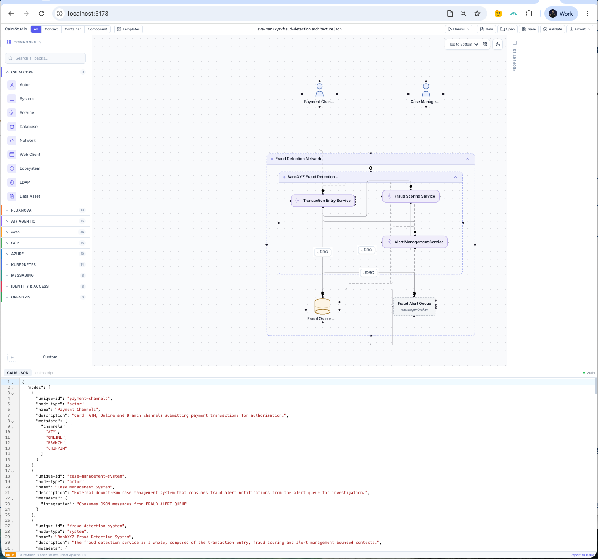

# BankXYZ Fraud Detection — CALM Architecture

A [FINOS CALM](https://calm.finos.org) 1.2 model of the [`examples/java-bankxyz_fraud_detection`](../../../examples/java-bankxyz_fraud_detection/) sample application: a Java 8 / Spring Boot real-time and batch fraud-scoring service, migrated from COBOL/CICS/Db2/IBM MQ on IBM z/OS.

## What's in this folder

| File | Purpose |
|---|---|
| [`java-bankxyz-fraud-detection.architecture.json`](java-bankxyz-fraud-detection.architecture.json) | The CALM architecture itself — open this in CALM Studio or validate it with `calm-cli` |
| [`CALM-Architecture-Steps.md`](CALM-Architecture-Steps.md) | Step-by-step record of how the architecture file was produced, validated, and loaded into Studio — read this if you're building a similar model for another app |

## What's modeled



*Rendered live in [CALM Studio](https://calm.finos.org/working-with-calm/calm-studio/) — see [Quick start](#quick-start) below to open it yourself.*

```
payment-channels (actor)
       │  interacts
       ▼
transaction-entry-service ──connects──► fraud-oracle-database (JDBC)
       │  connects                             ▲
       ▼                                       │ connects (JDBC)
fraud-scoring-service ─────connects────────────┘
       │
       │  (transaction-entry-service also connects directly to alert-management-service)
       ▼
alert-management-service ──connects (JDBC)──► fraud-oracle-database
       │  connects
       ▼
fraud-alert-queue (message-broker) ──interacts──► case-management-system (actor)

fraud-detection-system (system) = composed-of [transaction-entry-service, fraud-scoring-service, alert-management-service]
fraud-net (network) = deployed-in [fraud-detection-system, fraud-oracle-database, fraud-alert-queue]
```

**9 nodes** across 3 bounded-context services (mirroring the app's own `ARCHITECTURE.md`), an Oracle database, an ActiveMQ broker, two external actors (payment channels, case management), and the Docker network they share.

**10 relationships** — how those nodes talk to each other (REST calls, JDBC reads/writes, queue publish/consume) and how they're composed and deployed.

**2 flows** — the two business processes that traverse those relationships:
- `realtime-authorisation-flow` — the sub-180ms card/ATM/online authorisation path
- `nightly-batch-flow` — the scheduled (02:00) re-scoring of any pending transactions

**3 controls** — the compliance/business rules that actually matter in this domain, taken directly from the app's documented invariants:
- `realtime-sla` — 180ms SLA, breach always defaults to APPROVE
- `watchlist-screening` — OFAC/PEP hit forces score to 1.0, immediate escalation
- `monetary-precision` — BigDecimal only, no float/double (COMP-3 legacy invariant)

## Quick start

**Validate it** (needs [`calm-cli`](https://github.com/finos/architecture-as-code/tree/main/cli), `brew install calm-cli` or `npm install -g @finos/calm-cli`):

```bash
calm validate -a calm/examples/java-bankxyz_fraud_detection/java-bankxyz-fraud-detection.architecture.json --strict -f pretty
```

Expect `hasErrors: false`, `hasWarnings: false`.

**View/edit it visually** in [CALM Studio](https://calm.finos.org/working-with-calm/calm-studio/):

```bash
cd calm/calm-studio-server
make install   # first time only
make start     # → http://localhost:5173
```

Then in the browser: **Open** (or `Cmd/Ctrl+O`) → select `java-bankxyz-fraud-detection.architecture.json`.

Full details, including *why* each modelling choice was made, are in [`CALM-Architecture-Steps.md`](CALM-Architecture-Steps.md).
