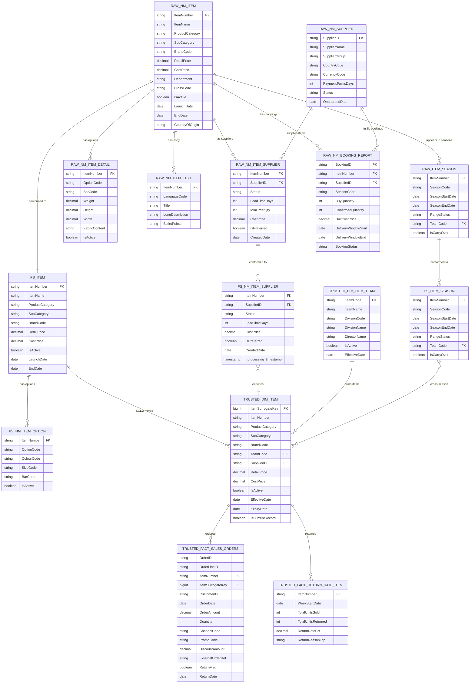
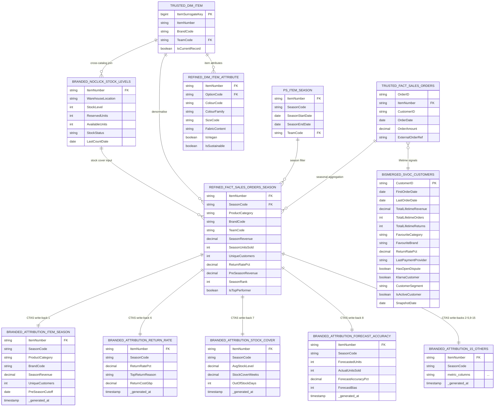
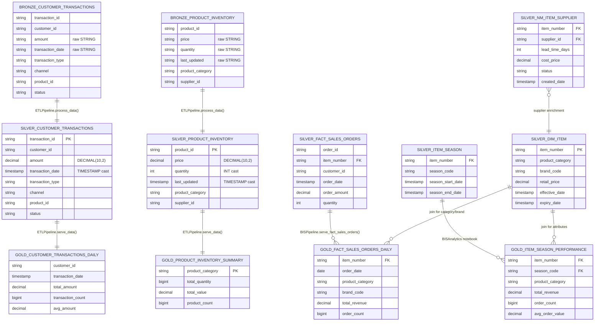
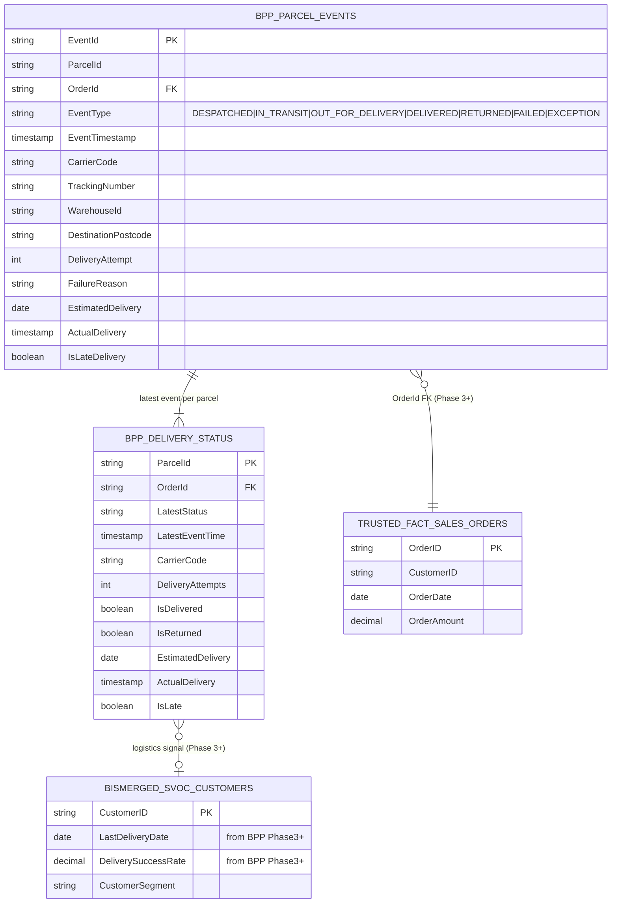
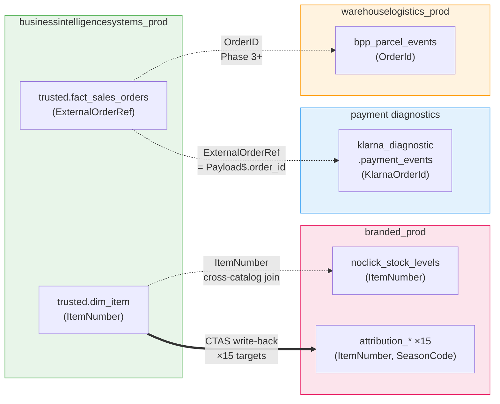

# Entity Relationship Diagram — project1_databricks_adf Hive Metastore

57 tables · 15 schemas · 6 domains · rendered in Mermaid (paste into https://mermaid.live) + DOT source for SVG.

---

## 1. Domain-Level Data Flow (Overview)

```mermaid
flowchart TD
    subgraph RAW["🟤 BRONZE — product_systems_raw"]
        nm_item["nm_item\n(ItemNumber PK)"]
        nm_item_supplier_raw["nm_item_supplier\n(ItemNumber,SupplierID)"]
        nm_item_detail["nm_item_detail\n(ItemNumber,OptionCode)"]
        nm_item_text["nm_item_text\n(ItemNumber,LanguageCode)"]
        nm_supplier["nm_supplier\n(SupplierID PK)"]
        nm_booking_report["nm_booking_report\n(BookingID PK)"]
        item_season_raw["item_season\n(ItemNumber,SeasonCode)"]
    end

    subgraph SILVER["🟡 SILVER — product_systems"]
        ps_nm_item_supplier["nm_item_supplier\n(conformed)"]
        ps_item_season["item_season\n(conformed · PARTITIONED)"]
        ps_nm_item_option["nm_item_option"]
        ps_item["item"]
        ps_item_text["item_text"]
    end

    subgraph TRUSTED["🟢 GOLD — trusted (star schema hub)"]
        dim_item["dim_item\n(SCD2 · ItemSurrogateKey PK)"]
        dim_item_team["dim_item_team\n(TeamCode PK)"]
        fact_sales_orders["fact_sales_orders\n(PARTITIONED BY OrderDate)"]
        fact_return_rate["fact_return_rate_item\n(ItemNumber,WeekStartDate)"]
    end

    subgraph REFINED["🔵 REFINED"]
        fso_season["fact_sales_orders_season\n(PARTITIONED BY SeasonCode)"]
        dim_item_attr["dim_item_attribute"]
    end

    subgraph BISMERGED["🔮 BISMERGED"]
        svoc["svoc_customers\n(CustomerID PK · ORPHAN)"]
    end

    subgraph BRANDED["🟣 BRANDED SPOKE — branded_prod"]
        noclick["noclick_stock_levels\n(wasb:// source)"]
        attribution["attribution_* ×15\n(CTAS write-backs)"]
    end

    subgraph GENERIC_ETL["⚙️ GENERIC ETL — bronze / silver / gold"]
        b_ct["bronze.customer_transactions"]
        s_ct["silver.customer_transactions"]
        g_ct["gold.customer_transactions__daily"]
        b_pi["bronze.product_inventory"]
        s_pi["silver.product_inventory"]
        g_pi["gold.product_inventory__summary"]
        g_fso["gold.fact_sales_orders_daily"]
        g_isp["gold.item_season_performance"]
        g_pps["gold.payment_provider_summary"]
    end

    subgraph PAYMENTS["💳 PAYMENTS — 5 diagnostic catalogs"]
        wp["wp_diagnostic\n.payment_events"]
        ap["ap_diagnostic\n.payment_events"]
        pp["pp_diagnostic\n.payment_events"]
        gp["gp_diagnostic\n.payment_events"]
        kl["klarna_diagnostic\n.payment_events"]
    end

    subgraph LOGISTICS["🚚 WAREHOUSE LOGISTICS — streaming"]
        bpp_events["bpp_parcel_events\n(Eventarc streaming)"]
        bpp_status["bpp_delivery_status\n(current snapshot)"]
    end

    %% Bronze → Silver
    nm_item --> ps_item
    nm_item --> nm_item_detail
    nm_item_supplier_raw -->|"conform"| ps_nm_item_supplier
    item_season_raw -->|"conform"| ps_item_season
    nm_supplier --> nm_item_supplier_raw

    %% Silver → Gold (trusted)
    ps_item -->|"SCD2 merge"| dim_item
    ps_nm_item_supplier -->|"join"| dim_item
    ps_item_season --> dim_item
    dim_item_team --> dim_item

    %% Star schema relationships
    fact_sales_orders -->|"ItemNumber FK"| dim_item
    fact_return_rate -->|"ItemNumber FK"| dim_item

    %% Gold → Refined
    dim_item -->|"denormalise"| fso_season
    fact_sales_orders -->|"seasonal agg"| fso_season
    ps_item_season -->|"season join"| fso_season
    dim_item --> dim_item_attr

    %% Refined → SVOC
    fact_sales_orders -->|"CustomerID"| svoc
    bpp_status -->|"logistics signal"| svoc

    %% CTAS write-back (BIS → Branded)
    fso_season ==>|"15×CTAS\nmaterialise_attribution_targets()"| attribution
    dim_item -->|"cross-catalog join\nItemNumber"| noclick

    %% Generic ETL
    b_ct -->|"process_data()"| s_ct --> g_ct
    b_pi -->|"process_data()"| s_pi --> g_pi
    fact_sales_orders -->|"BISPipeline"| g_fso
    ps_item_season -->|"BISAnalytics"| g_isp

    %% Payments
    wp --> g_pps
    ap --> g_pps
    pp --> g_pps
    gp --> g_pps
    kl --> g_pps
    fact_sales_orders -.->|"ExternalOrderRef\n↔ Payload$.order_id\ncross-catalog"| kl

    %% Logistics
    bpp_events -->|"latest status"| bpp_status
    fact_sales_orders -.->|"OrderId FK"| bpp_events

    classDef raw fill:#c8a97e,color:#000,stroke:#8a6a3e
    classDef silver fill:#f5e77a,color:#000,stroke:#c9b830
    classDef gold fill:#90c97e,color:#000,stroke:#4a8a3e
    classDef refined fill:#7eb0c9,color:#000,stroke:#3e6a8a
    classDef merged fill:#b07ec9,color:#000,stroke:#6a3e8a
    classDef branded fill:#c97eaf,color:#000,stroke:#8a3e6a
    classDef payments fill:#7ec9c5,color:#000,stroke:#3e8a87
    classDef logistics fill:#c9997e,color:#000,stroke:#8a5a3e

    class nm_item,nm_item_supplier_raw,nm_item_detail,nm_item_text,nm_supplier,nm_booking_report,item_season_raw raw
    class ps_nm_item_supplier,ps_item_season,ps_nm_item_option,ps_item,ps_item_text silver
    class dim_item,dim_item_team,fact_sales_orders,fact_return_rate gold
    class fso_season,dim_item_attr refined
    class svoc merged
    class noclick,attribution branded
    class b_ct,s_ct,g_ct,b_pi,s_pi,g_pi,g_fso,g_isp,g_pps raw
    class wp,ap,pp,gp,kl payments
    class bpp_events,bpp_status logistics
```



---

## 2. BIS Star Schema — Core Tables (detailed)



---

## 3. Refined + SVOC + Branded Write-backs



---

## 4. Payment Diagnostics — 5 Providers

```mermaid
erDiagram

    WP_PAYMENT_EVENTS {
        string EventId PK
        string EventType
        timestamp EventTimestamp
        string Payload "JSON: $.transaction_id $.amount $.currency $.status $.customer_email $.error_code"
        string GatewayReference
        string SiteId
        date EventDate
    }

    AP_PAYMENT_EVENTS {
        string EventId PK
        string EventType
        timestamp EventTimestamp
        string Payload "JSON: $.order_reference_id $.dispute_id $.amount.value $.amount.currencyCode $.reason_code"
        string MerchantId
        string MarketplaceId
        date EventDate
    }

    PP_PAYMENT_EVENTS {
        string EventId PK
        string EventType
        timestamp EventTimestamp
        string Payload "JSON: $.id $.status $.amount.value $.payer.email $.failure_reason"
        string PayPalAccountId
        date EventDate
    }

    GP_PAYMENT_EVENTS {
        string EventId PK
        string EventType
        timestamp EventTimestamp
        string Payload "JSON: $.result_code $.decline_reason"
        string MerchantId
        date EventDate
    }

    KLARNA_PAYMENT_EVENTS {
        string EventId PK
        string EventType
        timestamp EventTimestamp
        string Payload "JSON: $.order_id $.capture_amount $.settlement_date $.event_type"
        string KlarnaOrderId "promoted from Payload for index join"
        string MerchantReference
        date EventDate
    }

    TRUSTED_FACT_SALES_ORDERS {
        string OrderID
        string ExternalOrderRef "cross-catalog join key"
        date OrderDate
        decimal OrderAmount
    }

    GOLD_PAYMENT_PROVIDER_SUMMARY {
        string Provider PK
        bigint EventCount
        decimal TotalAmount
        timestamp _serving_timestamp
    }

    KLARNA_PAYMENT_EVENTS }o--o| TRUSTED_FACT_SALES_ORDERS : "KlarnaOrderId = ExternalOrderRef (cross-catalog reconciliation)"

    WP_PAYMENT_EVENTS ||--o{ GOLD_PAYMENT_PROVIDER_SUMMARY : "UNION ALL aggregate"
    AP_PAYMENT_EVENTS ||--o{ GOLD_PAYMENT_PROVIDER_SUMMARY : "UNION ALL aggregate"
    PP_PAYMENT_EVENTS ||--o{ GOLD_PAYMENT_PROVIDER_SUMMARY : "UNION ALL aggregate"
    GP_PAYMENT_EVENTS ||--o{ GOLD_PAYMENT_PROVIDER_SUMMARY : "UNION ALL aggregate"
    KLARNA_PAYMENT_EVENTS ||--o{ GOLD_PAYMENT_PROVIDER_SUMMARY : "UNION ALL aggregate"
```



---

## 5. Generic ETL Pipeline (etl_config.json)



---

## 6. Warehouse Logistics — Streaming Domain



---

## 7. Cross-Catalog Relationship Map



---

## 8. DBML — for dbdiagram.io interactive viewer

Paste the block below at https://dbdiagram.io to render an interactive ERD.

```dbml
// =====================================================================
// project1_databricks_adf — Hive Metastore DBML
// Paste at https://dbdiagram.io
// =====================================================================

Table product_systems_raw.nm_item {
  ItemNumber         varchar [pk, note: "ERP item identifier"]
  ItemName           varchar
  ProductCategory    varchar
  SubCategory        varchar
  BrandCode          varchar
  RetailPrice        decimal
  CostPrice          decimal
  Department         varchar
  ClassCode          varchar
  IsActive           boolean
  LaunchDate         date
  EndDate            date
  CountryOfOrigin    varchar
  _ingestion_timestamp timestamp
}

Table product_systems_raw.nm_supplier {
  SupplierID        varchar [pk]
  SupplierName      varchar
  SupplierGroup     varchar
  CountryCode       varchar
  CurrencyCode      varchar
  PaymentTermsDays  int
  Status            varchar
  OnboardedDate     date
}

Table product_systems_raw.nm_item_supplier {
  ItemNumber    varchar [ref: > product_systems_raw.nm_item.ItemNumber]
  SupplierID    varchar [ref: > product_systems_raw.nm_supplier.SupplierID]
  Status        varchar
  LeadTimeDays  int
  CostPrice     decimal
  IsPreferred   boolean
  CreatedDate   date

  indexes {
    (ItemNumber, SupplierID) [pk]
  }
}

Table product_systems_raw.nm_item_detail {
  ItemNumber  varchar [ref: > product_systems_raw.nm_item.ItemNumber]
  OptionCode  varchar
  BarCode     varchar
  Weight      decimal
  FabricContent varchar
  IsActive    boolean

  indexes {
    (ItemNumber, OptionCode) [pk]
  }
}

Table product_systems_raw.nm_item_text {
  ItemNumber    varchar [ref: > product_systems_raw.nm_item.ItemNumber]
  LanguageCode  varchar
  Title         varchar
  LongDescription varchar
  BulletPoints  varchar

  indexes {
    (ItemNumber, LanguageCode) [pk]
  }
}

Table product_systems_raw.item_season {
  ItemNumber      varchar [ref: > product_systems_raw.nm_item.ItemNumber]
  SeasonCode      varchar
  SeasonStartDate date
  SeasonEndDate   date
  RangeStatus     varchar
  TeamCode        varchar
  IsCarryOver     boolean

  indexes {
    (ItemNumber, SeasonCode) [pk]
  }
}

Table product_systems_raw.nm_booking_report {
  BookingID          varchar [pk]
  ItemNumber         varchar [ref: > product_systems_raw.nm_item.ItemNumber]
  SupplierID         varchar [ref: > product_systems_raw.nm_supplier.SupplierID]
  SeasonCode         varchar
  BuyQuantity        int
  ConfirmedQuantity  int
  UnitCostPrice      decimal
  DeliveryWindowStart date
  DeliveryWindowEnd   date
  BookingStatus       varchar
}

Table product_systems.item {
  ItemNumber      varchar [pk]
  ItemName        varchar
  ProductCategory varchar
  BrandCode       varchar
  RetailPrice     decimal
  IsActive        boolean
  LaunchDate      date
}

Table product_systems.nm_item_supplier {
  ItemNumber    varchar [ref: > product_systems.item.ItemNumber]
  SupplierID    varchar
  Status        varchar
  LeadTimeDays  int
  CostPrice     decimal
  IsPreferred   boolean
  CreatedDate   date
  _processing_timestamp timestamp

  indexes {
    (ItemNumber, SupplierID) [pk]
  }
}

Table product_systems.item_season {
  ItemNumber      varchar [ref: > product_systems.item.ItemNumber]
  SeasonCode      varchar
  SeasonStartDate date
  SeasonEndDate   date
  RangeStatus     varchar
  TeamCode        varchar
  IsCarryOver     boolean

  indexes {
    (ItemNumber, SeasonCode) [pk]
  }
}

Table product_systems.nm_item_option {
  ItemNumber   varchar [ref: > product_systems.item.ItemNumber]
  OptionCode   varchar
  ColourCode   varchar
  SizeCode     varchar
  BarCode      varchar
  IsActive     boolean

  indexes {
    (ItemNumber, OptionCode) [pk]
  }
}

Table trusted.dim_item_team {
  TeamCode      varchar [pk]
  TeamName      varchar
  DivisionCode  varchar
  DivisionName  varchar
  IsActive      boolean
}

Table trusted.dim_item {
  ItemSurrogateKey bigint [pk, increment]
  ItemNumber       varchar [note: "natural key; join on IsCurrentRecord=TRUE"]
  ProductCategory  varchar
  BrandCode        varchar
  TeamCode         varchar [ref: > trusted.dim_item_team.TeamCode]
  SupplierID       varchar
  RetailPrice      decimal
  IsCurrentRecord  boolean
  EffectiveDate    date
  ExpiryDate       date
}

Table trusted.fact_sales_orders {
  OrderID           varchar
  OrderLineID       varchar
  ItemNumber        varchar [ref: > trusted.dim_item.ItemNumber]
  ItemSurrogateKey  bigint  [ref: > trusted.dim_item.ItemSurrogateKey]
  CustomerID        varchar
  OrderDate         date
  OrderAmount       decimal
  ChannelCode       varchar
  ExternalOrderRef  varchar [note: "cross-catalog join key to klarna_diagnostic"]
  ReturnFlag        boolean
  ReturnDate        date

  indexes {
    (OrderID, ItemNumber) [pk]
    OrderDate
  }
}

Table trusted.fact_return_rate_item {
  ItemNumber       varchar [ref: > trusted.dim_item.ItemNumber]
  WeekStartDate    date
  TotalUnitsSold   int
  TotalUnitsReturned int
  ReturnRatePct    decimal
  ReturnReasonTop  varchar

  indexes {
    (ItemNumber, WeekStartDate) [pk]
  }
}

Table refined.fact_sales_orders_season {
  ItemNumber       varchar [ref: > trusted.dim_item.ItemNumber]
  SeasonCode       varchar [ref: > product_systems.item_season.SeasonCode]
  ProductCategory  varchar
  BrandCode        varchar
  TeamCode         varchar
  SeasonRevenue    decimal
  SeasonUnitsSold  int
  UniqueCustomers  int
  ReturnRatePct    decimal
  SeasonRank       int
  IsTopPerformer   boolean

  indexes {
    (ItemNumber, SeasonCode) [pk]
  }
}

Table refined.dim_item_attribute {
  ItemNumber    varchar [ref: > trusted.dim_item.ItemNumber]
  OptionCode    varchar
  ColourCode    varchar
  ColourFamily  varchar
  SizeCode      varchar
  IsVegan       boolean
  IsSustainable boolean

  indexes {
    (ItemNumber, OptionCode) [pk]
  }
}

Table bismerged.svoc_customers {
  CustomerID             varchar [pk]
  FirstOrderDate         date
  LastOrderDate          date
  TotalLifetimeRevenue   decimal
  TotalLifetimeOrders    int
  FavouriteCategory      varchar
  LastPaymentProvider    varchar
  HasOpenDispute         boolean
  KlarnaCustomer         boolean
  LastDeliveryDate       date
  CustomerSegment        varchar
  SnapshotDate           date
}

Table branded_prod.noclick_stock_levels {
  ItemNumber        varchar [ref: > trusted.dim_item.ItemNumber, note: "cross-catalog join"]
  WarehouseLocation varchar
  StockLevel        int
  AvailableUnits    int
  StockStatus       varchar
  LastCountDate     date
}

Table branded_prod.attribution_item_season {
  ItemNumber      varchar [ref: > refined.fact_sales_orders_season.ItemNumber]
  SeasonCode      varchar [ref: > refined.fact_sales_orders_season.SeasonCode]
  SeasonRevenue   decimal
  UniqueCustomers int
  PreSeasonCutoff date
  _generated_at   timestamp

  indexes {
    (ItemNumber, SeasonCode) [pk]
  }
}

// Attribution tables 2-15 follow same structure (ItemNumber, SeasonCode PK + metric columns)
// See 05_branded_prod.sql for full definitions of:
//   attribution_item_team, attribution_item_brand, attribution_sales_weekly,
//   attribution_sales_monthly, attribution_return_rate, attribution_stock_cover,
//   attribution_forecast_accuracy, attribution_supplier_lead_time,
//   attribution_noclick_opportunity, attribution_svoc_segment,
//   attribution_price_elasticity, attribution_channel_mix,
//   attribution_markdown_impact, attribution_new_season_launch

Table wp_diagnostic.payment_events {
  EventId          varchar [pk]
  EventType        varchar
  EventTimestamp   timestamp
  Payload          varchar [note: "JSON: $.transaction_id $.amount $.currency $.status $.customer_email $.error_code"]
  GatewayReference varchar
  EventDate        date
}

Table ap_diagnostic.payment_events {
  EventId        varchar [pk]
  EventType      varchar
  EventTimestamp timestamp
  Payload        varchar [note: "JSON: $.order_reference_id $.dispute_id $.amount.value $.amount.currencyCode"]
  MerchantId     varchar
  EventDate      date
}

Table pp_diagnostic.payment_events {
  EventId        varchar [pk]
  EventType      varchar
  EventTimestamp timestamp
  Payload        varchar [note: "JSON: $.id $.status $.amount.value $.payer.email $.failure_reason"]
  EventDate      date
}

Table gp_diagnostic.payment_events {
  EventId        varchar [pk]
  EventType      varchar
  EventTimestamp timestamp
  Payload        varchar [note: "JSON: $.result_code $.decline_reason"]
  MerchantId     varchar
  EventDate      date
}

Table klarna_diagnostic.payment_events {
  EventId           varchar [pk]
  EventType         varchar
  EventTimestamp    timestamp
  Payload           varchar [note: "JSON: $.order_id $.capture_amount $.settlement_date"]
  KlarnaOrderId     varchar [note: "promoted from Payload for indexed join"]
  MerchantReference varchar
  EventDate         date
}

Table warehouselogistics_prod.bpp_parcel_events {
  EventId           varchar [pk]
  ParcelId          varchar
  OrderId           varchar [ref: > trusted.fact_sales_orders.OrderID]
  EventType         varchar
  EventTimestamp    timestamp
  CarrierCode       varchar
  TrackingNumber    varchar
  DeliveryAttempt   int
  FailureReason     varchar
  EstimatedDelivery date
  ActualDelivery    timestamp
  IsLateDelivery    boolean
}

Table warehouselogistics_prod.bpp_delivery_status {
  ParcelId        varchar [pk]
  OrderId         varchar [ref: > trusted.fact_sales_orders.OrderID]
  LatestStatus    varchar
  CarrierCode     varchar
  DeliveryAttempts int
  IsDelivered     boolean
  IsReturned      boolean
  IsLate          boolean
}

// Cross-catalog relationship (cross-domain)
Ref: klarna_diagnostic.payment_events.KlarnaOrderId > trusted.fact_sales_orders.ExternalOrderRef

Table bronze.customer_transactions {
  transaction_id   varchar
  customer_id      varchar
  amount           varchar [note: "raw STRING"]
  transaction_date varchar [note: "raw STRING"]
  transaction_type varchar
  channel          varchar
}

Table silver.customer_transactions {
  transaction_id   varchar [pk]
  customer_id      varchar
  amount           decimal [note: "DECIMAL(10,2)"]
  transaction_date timestamp
  transaction_type varchar
  channel          varchar
}

Table gold.customer_transactions__daily_transactions {
  customer_id       varchar
  transaction_date  timestamp
  total_amount      decimal
  transaction_count bigint
  avg_amount        decimal

  indexes {
    (customer_id, transaction_date) [pk]
  }
}

Table bronze.product_inventory {
  product_id       varchar
  price            varchar [note: "raw STRING"]
  quantity         varchar [note: "raw STRING"]
  product_category varchar
  supplier_id      varchar
}

Table silver.product_inventory {
  product_id       varchar [pk]
  price            decimal [note: "DECIMAL(10,2)"]
  quantity         int
  product_category varchar
  supplier_id      varchar
}

Table gold.product_inventory__inventory_summary {
  product_category varchar [pk]
  total_quantity   bigint
  total_value      decimal
  product_count    bigint
}

Ref: bronze.customer_transactions.transaction_id > silver.customer_transactions.transaction_id
Ref: silver.customer_transactions.customer_id > gold.customer_transactions__daily_transactions.customer_id
Ref: bronze.product_inventory.product_id > silver.product_inventory.product_id
Ref: silver.product_inventory.product_category > gold.product_inventory__inventory_summary.product_category
```
